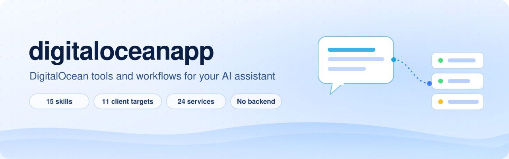
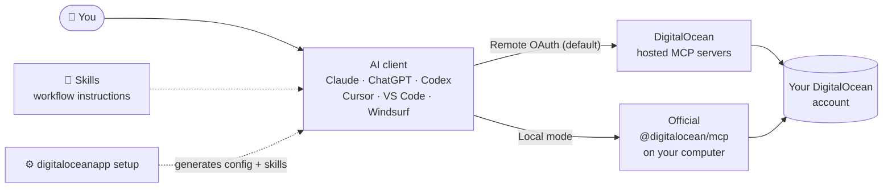

<p align="center">
  <picture>
    <source media="(prefers-color-scheme: dark)" srcset="docs/assets/banner-dark.svg">
    
  </picture>
</p>

<p align="center">
  <b>Ask your AI assistant what's running on DigitalOcean, why a deploy failed, or what a change will cost,<br>and get answers grounded in your real account.</b>
</p>

<p align="center">
  <a href="https://github.com/DangerMouseUK/digitaloceanapp/actions/workflows/validate.yml"></a>
  <a href="CHANGELOG.md"></a>
  
  <a href="LICENSE"></a>
  
</p>

<p align="center">
  <a href="#-quick-start">Quick start</a> ·
  <a href="#-what-you-can-ask">What you can ask</a> ·
  <a href="#-how-it-works">How it works</a> ·
  <a href="#-skills">Skills</a> ·
  <a href="#-supported-clients">Clients</a> ·
  <a href="#-safety-and-privacy">Safety</a> ·
  <a href="#-contributing">Contributing</a>
</p>

---

**digitaloceanapp** connects Claude, ChatGPT, Codex, Cursor, VS Code, Windsurf and other MCP clients to [DigitalOcean's official MCP servers](https://github.com/digitalocean-labs/mcp-digitalocean), and adds **15 skills**: step-by-step workflows that teach your assistant how to inventory an account, troubleshoot App Platform deployments, review databases and Kubernetes clusters, and separate invoice facts from cost estimates.

Your assistant talks to DigitalOcean directly. This project has no server, no proxy and no telemetry, and it never sees your token or your account data. It generates configuration files and skills, then gets out of the way.

## ⚡ Quick start

### Claude Code: two commands

```sh
claude plugin marketplace add DangerMouseUK/digitaloceanapp
claude plugin install digitaloceanapp@digitaloceanapp
```

Run `/mcp` in a session and sign in with DigitalOcean. That installs the **Core** services with remote OAuth. For other services or connection modes, see the [Claude Code guide](clients/claude-code/README.md).

### Any other client

You need **Node.js 22+**, npm and an MCP-compatible AI client.

```sh
git clone https://github.com/DangerMouseUK/digitaloceanapp.git
cd digitaloceanapp
npm ci
node bin/digitaloceanapp.js setup
```

Pick your client, keep the defaults (**Remote OAuth** and the **Core** preset), and choose a new output folder. Setup writes the configuration, the skills and an `INSTALL.md` with instructions for your client. It never edits your existing client settings, so you stay in control of what gets merged.

Want to look before anything is written?

```sh
node bin/digitaloceanapp.js setup --client codex --dry-run
```

A dry run lists the services, skills, install locations and sign-in steps, and writes no files. Add `--json` for machine-readable output.

## 💬 What you can ask

Once connected, ask in plain language:

| You ask                                                     | Your assistant                                                                                             |
| ----------------------------------------------------------- | ---------------------------------------------------------------------------------------------------------- |
| _"What do I have running on DigitalOcean?"_                 | Lists resources across connected services, follows pagination and calls out anything it couldn't inspect.  |
| _"Why did my latest deployment fail?"_                      | Finds the app and deployment, reads status and relevant logs, and explains the evidence-backed next steps. |
| _"Check this app before release."_                          | Reviews the app and your proposed changes for deployment blockers and unchecked gaps, without deploying.   |
| _"Review my App Platform apps for problems or oversizing."_ | Checks deployment health, configuration anomalies, dependencies and sizing signals.                        |
| _"Why can app-a not reach db-a?"_                           | Traces explicit resource references, firewall rules and VPCs, without running active probes.               |
| _"Review backups for these databases and Droplets."_        | Reports backup coverage and freshness against your requirements, without claiming untested restores work.  |
| _"What would adding another app instance cost?"_            | Uses official prices and states its assumptions, keeping known, calculated and estimated amounts apart.    |
| _"How do I configure a custom domain on App Platform?"_     | Searches current official DigitalOcean documentation. No account credentials needed.                       |

Review and troubleshooting skills inspect resources without changing them. Changes happen only when you ask for a specific one, and the assistant confirms the exact target first and checks the result afterwards.

## 🧭 How it works



1. **Setup** generates client-specific MCP configuration and a skills folder in a new directory. It runs offline.
2. **You install** them into your client by following the generated `INSTALL.md`.
3. **Your client** connects straight to DigitalOcean, either to its hosted servers with OAuth sign-in, or through the official local package with an API token you supply.
4. **Skills** guide each task: which tools to call, how to follow pagination, how to report missing data as missing, and when to stop and ask.

## 📘 Skills

Each skill is a standalone `SKILL.md` that describes when it applies, which services it uses, how to investigate, and what it is allowed to do.

| Area               | Skill                                                                      | What it does                                                                    |
| ------------------ | -------------------------------------------------------------------------- | ------------------------------------------------------------------------------- |
| **Explore**        | [`infrastructure-inventory`](skills/infrastructure-inventory/SKILL.md)     | Inventory resources across connected services and report coverage gaps          |
|                    | [`infrastructure-explanation`](skills/infrastructure-explanation/SKILL.md) | Explain how your account is organized and how resources connect                 |
|                    | [`account-audit`](skills/account-audit/SKILL.md)                           | Find operational issues, possible waste and configuration concerns              |
|                    | [`documentation-research`](skills/documentation-research/SKILL.md)         | Find and explain current official DigitalOcean documentation                    |
| **App Platform**   | [`app-platform-review`](skills/app-platform-review/SKILL.md)               | Review app health, configuration, dependencies and possible oversizing          |
|                    | [`deployment-review`](skills/deployment-review/SKILL.md)                   | Spot failed, cancelled or degraded deployments and repeated patterns            |
|                    | [`deployment-preflight`](skills/deployment-preflight/SKILL.md)             | Check an app and proposed changes for blockers before release                   |
|                    | [`app-troubleshooting`](skills/app-troubleshooting/SKILL.md)               | Investigate a failed or unhealthy deployment from status and logs               |
| **Infrastructure** | [`database-review`](skills/database-review/SKILL.md)                       | Managed database health, capacity, maintenance and connectivity                 |
|                    | [`droplet-review`](skills/droplet-review/SKILL.md)                         | Droplet state, capacity and reachability, with no SSH or power actions          |
|                    | [`kubernetes-review`](skills/kubernetes-review/SKILL.md)                   | Cluster and node-pool health, capacity and upgrade concerns                     |
|                    | [`networking-review`](skills/networking-review/SKILL.md)                   | DNS, firewall, load balancer and VPC connectivity questions                     |
|                    | [`recovery-review`](skills/recovery-review/SKILL.md)                       | Database and Droplet backup coverage, freshness and recovery dependencies       |
| **Cost**           | [`cost-review`](skills/cost-review/SKILL.md)                               | Billing, potential savings and the cost of a proposed change                    |
| **Changes**        | [`safe-operations`](skills/safe-operations/SKILL.md)                       | Requested changes with exact target checks, consequence review and verification |

The infrastructure skills need the `infrastructure` preset (or the individual services they use).

## 🧩 Supported clients

| Client                                  | `--client`       | Setup guide                                                       |
| --------------------------------------- | ---------------- | ----------------------------------------------------------------- |
| Claude Code                             | `claude-code`    | [Plugin, configuration and skills](clients/claude-code/README.md) |
| Claude (claude.ai, Desktop, mobile)     | `claude`         | [Custom connectors and skill uploads](clients/claude/README.md)   |
| Claude Desktop local MCP                | `claude-desktop` | [Connectors and local MCP](clients/claude-desktop/README.md)      |
| Claude API (Messages MCP connector)     | `anthropic-api`  | [Request fragment](clients/anthropic-api/README.md)               |
| ChatGPT                                 | `chatgpt`        | [Remote connections and plugin setup](clients/chatgpt/README.md)  |
| Codex                                   | `codex`          | [Configuration and skills](clients/codex/README.md)               |
| OpenAI Responses API (remote MCP)       | `openai-api`     | [Request fragment](clients/openai-api/README.md)                  |
| VS Code                                 | `vscode`         | [Configuration and skills](clients/vscode/README.md)              |
| Cursor                                  | `cursor`         | [Configuration and skills](clients/cursor/README.md)              |
| Windsurf                                | `windsurf`       | [Configuration and skills](clients/windsurf/README.md)            |
| Portable plugin (Codex, Claude Code, …) | `plugin`         | [Plugin package](clients/plugin/README.md)                        |

Connection modes and skill installation differ by client. ChatGPT and the Claude apps use remote connections; Claude Desktop local configuration covers Windows and macOS. The two API targets produce request fragments for your own code and use a DigitalOcean API token. See the [compatibility notes](docs/clients.md) for details.

## 🎛️ Choose your services

Start with what you use. Every extra server adds tools your assistant has to choose between.

| Preset           | Includes                                                                                     |
| ---------------- | -------------------------------------------------------------------------------------------- |
| `core` (default) | Accounts, App Platform, Insights, Documentation                                              |
| `app-platform`   | Core plus Container Registry, Spaces and Networking                                          |
| `infrastructure` | Accounts, Droplets, Databases, Kubernetes, Networking, Volumes, NFS, Insights, Documentation |
| `full`           | All 21 services in the reviewed registry, including Functions and AI inference services      |

Or pick individual services:

```sh
node bin/digitaloceanapp.js setup --client cursor --services apps,docs --output ./do-config
```

The output directory must be new and its parent must exist. Run `node bin/digitaloceanapp.js services` for the full list, or browse the [service reference](docs/supported-services.md).

## 🔐 Authentication

| Mode                       | How you sign in                                                      | Available for                                              |
| -------------------------- | -------------------------------------------------------------------- | ---------------------------------------------------------- |
| **Remote OAuth** (default) | Your client opens DigitalOcean's sign-in page. No token to manage.   | All clients except the API targets                         |
| Remote API token           | `DIGITALOCEAN_API_TOKEN` through your client's secret input          | Codex, VS Code, Cursor, Claude Code, Windsurf, API targets |
| Local                      | Runs the pinned official `@digitalocean/mcp` package with your token | Clients that support local MCP servers (`--mode local`)    |

Setup writes only references to credentials, never their values. Public Documentation needs no credentials at all. More detail: [authentication](docs/authentication.md), [remote mode](docs/remote-mode.md), [local mode](docs/local-mode.md).

## 🩺 Check, diagnose and upgrade

```sh
node bin/digitaloceanapp.js validate --path ./do-config   # check generated files
node bin/digitaloceanapp.js doctor   --path ./do-config   # also check local prerequisites
```

Both run offline. `doctor` reports whether a required token variable is set without ever printing it. Add `--json` for redacted reports with stable check codes and corrective actions ([format](docs/diagnostics.md)). Confirm the live connection in your client's MCP settings.

<details>
<summary><b>Upgrading an existing bundle</b></summary>

<br>

Preview the changes, then generate a replacement in a new directory:

```sh
node bin/digitaloceanapp.js upgrade --path "../My old bundle" --dry-run
node bin/digitaloceanapp.js upgrade --path "../My old bundle" --output "../My new bundle"
```

The upgrade keeps your client, services, platform and connection mode, and writes a `MIGRATE.md` that flags differences and customizations to review. Your old bundle and client settings are left untouched. Bundles from 1.0.0-rc.3 onwards record file fingerprints, so later upgrades can tell release changes from your own edits. See [upgrading](docs/upgrading.md).

</details>

<details>
<summary><b>All CLI commands</b></summary>

<br>

| Command    | Purpose                                                           |
| ---------- | ----------------------------------------------------------------- |
| `setup`    | Generate a configuration and skills bundle (interactive or flags) |
| `services` | List available services and presets                               |
| `validate` | Check a generated bundle                                          |
| `doctor`   | Check a bundle plus local prerequisites                           |
| `upgrade`  | Create an updated bundle from an older one                        |

Run `node bin/digitaloceanapp.js --help` for every option. Stuck? Start with [troubleshooting](docs/troubleshooting.md).

</details>

## 🛡️ Safety and privacy

> [!IMPORTANT]
> DigitalOcean's tools can change and delete infrastructure. Skills guide your assistant's behavior, but **they cannot enforce read-only access**. Use appropriately scoped DigitalOcean access and keep your client's tool approval prompts on.

- **No middleman.** No backend, proxy, telemetry or account database. Your AI client and DigitalOcean handle requests under their own policies.
- **No secrets in setup.** Setup never asks for a token and writes only credential references.
- **Honest reporting.** Skills report unavailable data as unavailable rather than treating it as zero, and keep findings in your AI client.
- **Explicit changes only.** An audit or cleanup request produces candidates, not deletions.

Read the [security model](docs/security.md), [privacy statement](docs/privacy.md) and [known limitations](docs/limitations.md). Report vulnerabilities through [private security reporting](SECURITY.md).

## 🚦 Project status

**Release candidate `1.0.0-rc.3`.** Client configurations are experimental templates covered by automated format and packaging tests on Windows, macOS and Linux. Synthetic skill workflows have been exercised by a separately authorized evaluator, with [results and limits recorded](docs/acceptance.md). Authenticated testing in live clients is still pending, so no client and mode combination is certified yet. The [V3 roadmap](docs/v3-roadmap.md) tracks what's next.

Tried it with your client? Results from real setups help close the acceptance gaps. [Open an issue](https://github.com/DangerMouseUK/digitaloceanapp/issues) and tell us what worked (please leave out credentials and account data).

## 🤝 Contributing

Improvements to skills, client setup and service coverage are welcome. See [CONTRIBUTING.md](CONTRIBUTING.md) for the workflow; coding agents should follow [AGENTS.md](AGENTS.md).

```sh
npm ci
npm run check
```

Client configurations and the service reference are generated from the registry with `npm run generate`. The test suite covers client formats, CLI behavior, credential handling and package installation.

## 📄 License

[MIT](LICENSE). digitaloceanapp is an independent community project. It is not an official DigitalOcean product or an endorsed integration.
